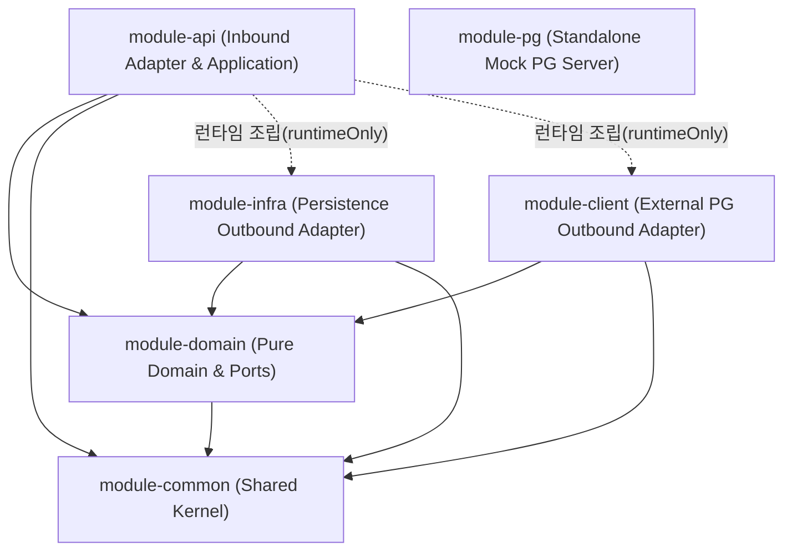

# ADR-0001: 헥사고날 아키텍처 기반 멀티 모듈 구조 및 결제 도메인 설계

- **상태(Status)**: Accepted (Amended by [ADR-0007](0007-pg-client-module-design.md))
- **영향 범위**: 전체 모듈 (`module-api`, `module-domain`, `module-infra`, `module-client`, `module-common`, `module-pg`)

---

## 1. 배경 (Context)
결제 및 뱅킹 서비스의 확장성, 도메인 순수성 유지, 그리고 유지보수성을 극대화하기 위해 단일 모놀리식 모듈 대신 **헥사고날 아키텍처(Ports and Adapters)** 원칙을 적용한 멀티 모듈 구조가 필요했습니다.

특히 핵심 비즈니스 로직이 특정 웹 프레임워크(Spring MVC)나 데이터베이스 기술(Spring Data JPA / MySQL), 외부 API 클라이언트(OpenFeign)에 강하게 결합되지 않도록 분리하여, 순수한 Kotlin 코드로 도메인 모델을 보호하는 것이 핵심 목표입니다.

---

## 2. 결정 사항 (Decision)
시스템을 역할과 의존성 방향에 따라 다음과 같은 멀티 모듈로 분리하여 구축합니다.

### 2.1. 모듈 구성 및 의존성 방향

1. **`module-common`**: 공통 예외 규격(`ErrorCode`, `BusinessException`), 분산 ID 생성기(`SnowflakeIdGenerator`), 유틸리티 등 프로젝트 전반에서 공유되는 모듈입니다.
2. **`module-domain`**: 순수 비즈니스 규칙과 도메인 엔티티(`Payment`, `Account`, `User` 등) 및 외부 연동을 위한 추상 포트(`PaymentRepository`, `AccountRepository`, `PgPort` 등)를 정의합니다. Spring이나 JPA 등 외부 프레임워크 의존성을 배제한 **Pure Kotlin** 모듈입니다.
3. **`module-infra`**: 데이터베이스 영속성(JPA Entity, Spring Data JPA Repository, Adapter) 등 인프라 기술 세부사항을 구현하는 Outbound Adapter 모듈입니다.
4. **`module-client`**: 외부 PG사 API 연동(`OpenFeign`, `Resilience4j` 서킷 브레이커)을 담당하는 Outbound Adapter 모듈입니다. ([ADR-0007](0007-pg-client-module-design.md)에서 확장)
5. **`module-api`**: 클라이언트 요청의 진입점(Controller, Interceptor, ArgumentResolver), 애플리케이션 유스케이스 조율(Facade), 백그라운드 스케줄러 및 Spring Boot 애플리케이션 실행을 담당합니다.
6. **`module-pg`**: 로컬 및 통합 테스트 환경에서 외부 결제 대행사 역할을 시뮬레이션하는 독립 실행형 Mock PG 서버입니다.

### 2.2. 결제 도메인 및 포트-어댑터 설계
- **`Payment`**: 결제 상태(`PENDING`, `APPROVING`, `SUCCESS`, `FAILED`, `CANCELLED`)와 상태 전이 불변식을 캡슐화한 순수 도메인 모델입니다.
- **`PaymentRepository` (Outbound Port)**: 영속성 처리를 위해 `module-domain`에 정의된 인터페이스입니다.
- **`PaymentRepositoryAdapter` (Outbound Adapter)**: `module-infra`에서 `PaymentRepository` 포트를 구현하며, 내부적으로 `PaymentJpaRepository`를 사용해 도메인 모델(`Payment`)과 JPA 엔티티(`PaymentJpaEntity`) 간 변환(Mapping)을 수행합니다.

---

## 3. 결과 및 영향 (Consequences)
- **장점**:
  - 데이터베이스 스키마나 외부 연동 기술이 변경되어도 `module-domain`의 핵심 비즈니스 로직은 영향을 받지 않습니다.
  - 모듈 간 컴파일 타임 의존성이 단방향(외부 Adapter ➔ 내부 Domain)으로 강제되어 아키텍처 경계 침범을 원천 방지합니다.
  - 도메인 단위 테스트 작성 시 무거운 Spring 컨텍스트 없이 순수 Kotlin 테스트로 빠르게 검증할 수 있습니다.
- **단점 및 트레이드오프**:
  - 도메인 모델(`Payment`, `Account`)과 영속성 엔티티(`PaymentJpaEntity`, `AccountJpaEntity`)를 분리함에 따라 상호 변환(Mapper) 보일러플레이트 코드가 발생합니다.
